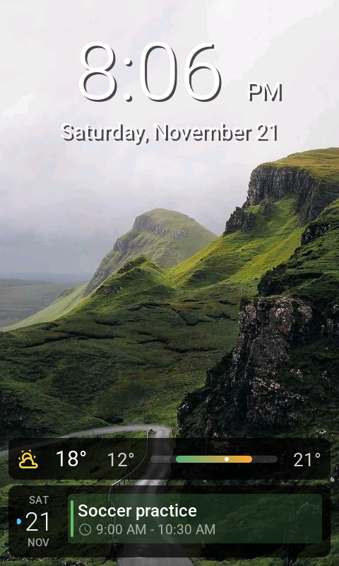
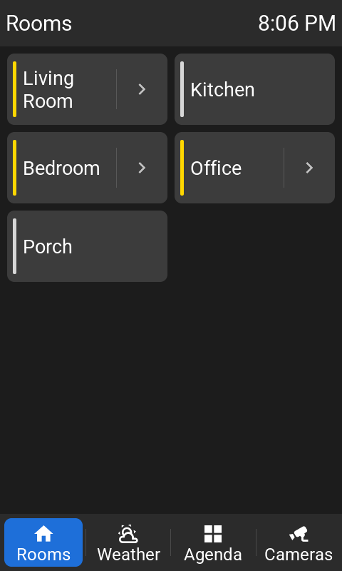
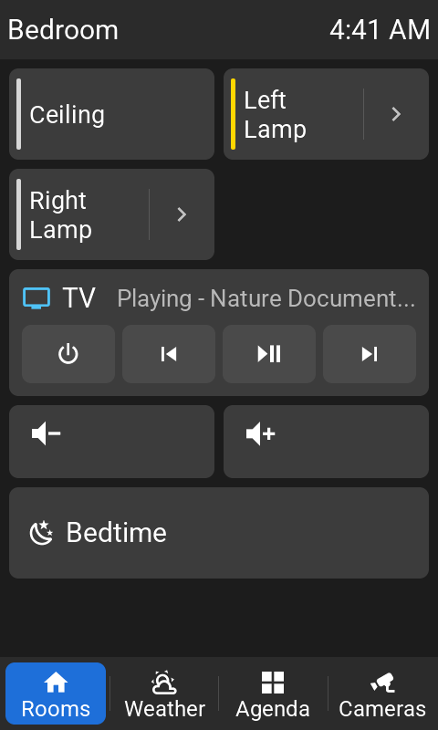
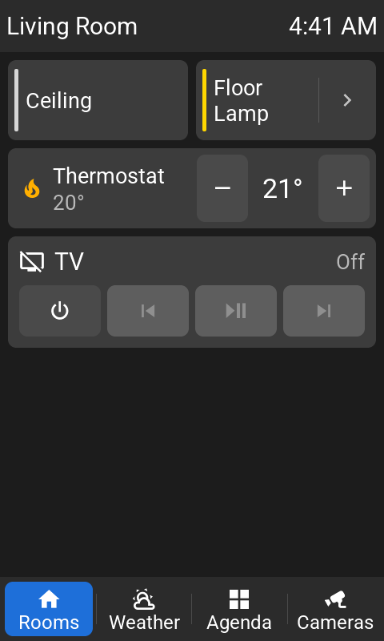
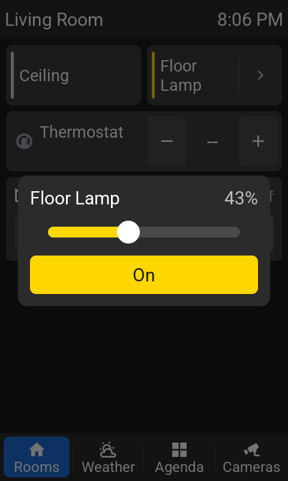
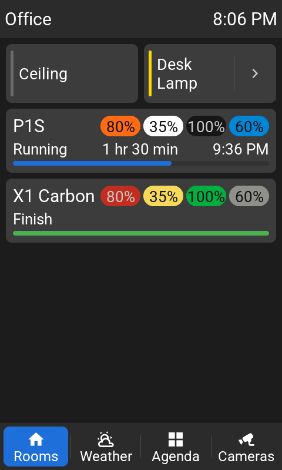
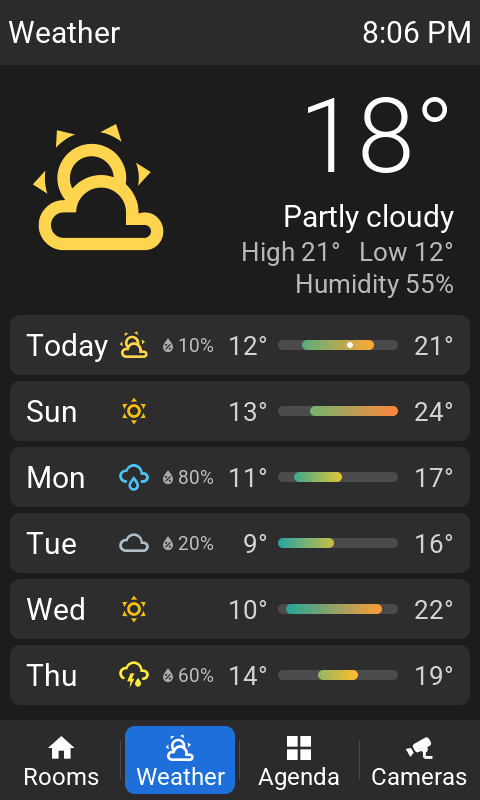
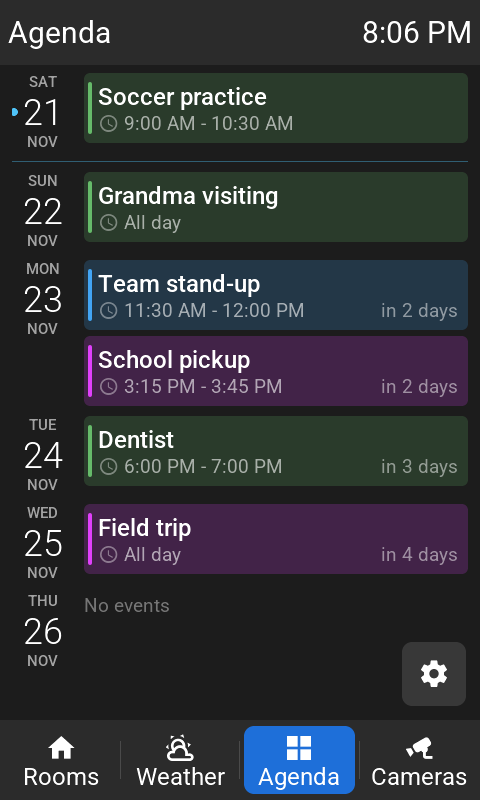
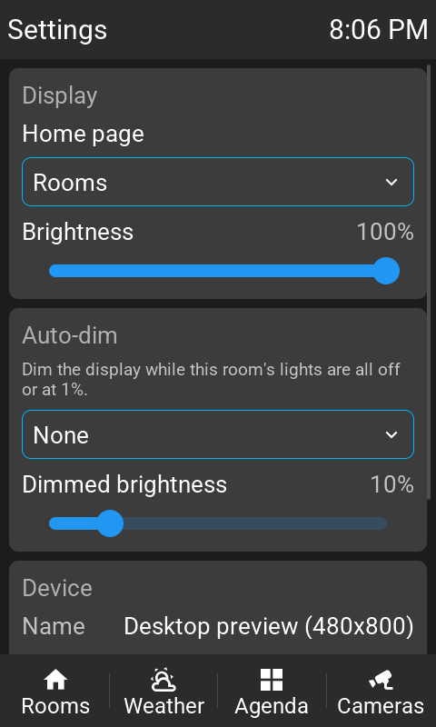

# ESPHome + LVGL panels for Home Assistant

[](https://ko-fi.com/S6S21K2LK2)

Wall and bedside touch panels on cheap ESP32 displays, in plain ESPHome YAML: lighting by
room, weather, your calendars, cameras, and a photo screensaver, all talking straight to
Home Assistant. No browser, no dashboard server.

| Screensaver | Rooms | A room |
| --- | --- | --- |
|  |  |  |

| Thermostat and TV | Brightness | Printers |
| --- | --- | --- |
|  |  |  |

| Weather | Agenda | Settings |
| --- | --- | --- |
|  |  |  |

*The demo house, rendered with `tools/snapshot.py`.*

## What's in it

* **Rooms**: a tile per room; tap to toggle the room, open its page for each light.
  Dimmable lights get a brightness pop-up. Rooms can hold a TV card, volume buttons and
  script buttons.
* **Weather**: now, and six days with range bars on a shared scale, like Home Assistant's
  forecast card.
* **Agenda**: the next month from your Home Assistant calendars, grouped by day; each panel
  can hide calendars.
* **Cameras**: two live feeds from go2rtc, tap for fullscreen.
* **3D printers** (Bambu Lab): progress, time left and the AMS trays' colours, from the
  [ha-bambulab](https://github.com/greghesp/ha-bambulab) or [printstream](https://printstream.app)
  integration. Thermostat and number steppers too.
* **Screensaver**: after a while untouched, the time, today's weather and today's events,
  over your photos (a folder, or an Immich album) or a still image. Tap the weather or
  events to go there.
* **Settings**: press and hold the clock (top right) to open it. Home page, brightness,
  auto-dim (dims the display while a room's lights are off or at 1%) and the panel's
  network details.
* **Voice** on the board with a microphone: say "Okay Nabu". Needs an Assist pipeline in
  Home Assistant; see [Voice](docs/getting-started.md#voice).

## Boards

| Board | Screen | Example |
| --- | --- | --- |
| Sunton `ESP32-8048S050` 5" ([AliExpress](https://www.aliexpress.com/item/1005004952694042.html)) | 480x800 | `sunton-50-example.yaml` |
| Sunton `ESP32-8048S043` 4.3" ([AliExpress](https://www.aliexpress.com/item/1005004788147691.html)) | 480x800 | `sunton-43-example.yaml` |
| Guition `JC3248W535` 3.5" ([AliExpress](https://www.aliexpress.com/item/1005007566046827.html)) | 320x480 | `guition-35-example.yaml` |
| Guition `JC4880P443C` 4.3", ESP32-P4, mic and speaker | 480x800 | `guition-43-example.yaml` |

The Sunton 2.8" (`ESP32-2432S028R` and its ILI9342 revision) and the Elecrow CrowPanel
`DIS05035H` are deprecated: too slow for this layout, they keep a simple page of lights
(see [docs/classic-layouts.md](docs/classic-layouts.md)). Details and adding a board:
[docs/boards.md](docs/boards.md).

## Getting started

1. Copy the example for your board to a config of your own and set its name.
2. Add `secrets.yaml` (Wi-Fi and an API key), flash it, and add it in Home Assistant.
3. In Home Assistant, on the device's **Configure** page, turn on **Allow the device to
   perform Home Assistant actions**.
4. Copy the demo house (`cp -r demo private`), point your config's `rooms:` at
   `private/pages.yaml`, and change the rooms and entities to yours.

On the panel, the tabs along the bottom switch pages, and pressing and holding the clock in
the top-right corner opens **Settings**: the home page, brightness, auto-dim and the
panel's network details.

[docs/getting-started.md](docs/getting-started.md) walks through it, including your weather,
cameras and photos. [docs/widgets.md](docs/widgets.md) lists every widget and how to use it.


## How it's organised

```
<board>-example.yaml   example configs (copy one; your own configs are git-ignored)
common.yaml            Wi-Fi, API, OTA and a few diagnostics, shared by every config
boards/                one include per board: hardware + screen size + Cameras page
devices/               hardware only: display, touch, backlight, audio
layouts/ui/            the panel layout: header, tabs, Weather, Agenda, screensaver, Settings
  sizes/               the layout's sizes per screen (fonts, tile heights, positions)
layouts/widgets/       the widgets you build your pages from, one line each
  parts/               what they're made of: <name>.yaml is drawn, <name>.sensors.yaml
                       feeds it from Home Assistant; base/ holds the templates
layouts/common/        header and boot screen, shared with the classic layouts
demo/                  a made-up house: the Rooms tab and each room's page to copy
private/               yours: pages and house settings (git-ignored)
components/            mjpeg_stream, the camera feeds' decoder
features/              optional extras (voice, diagnostics, Bluetooth proxy, ...)
tools/                 checks, the desktop preview/screenshots, the photo-frame service
layouts/320x240/, layouts/480x320/   the classic layouts, for the deprecated boards
```

A panel config is four includes:

```yaml
packages:
  common: !include common.yaml
  board: !include boards/sunton-50.yaml   # the hardware, sized for this screen
  ui: !include layouts/ui/layout.yaml     # the layout
  rooms: !include private/pages.yaml      # your Rooms tab and each room's page
```

## Optional features

Opt in from a config's `packages:`, after `ui:`.

* `features/diagnostics/memory.yaml`, `psram.yaml`: heap, loop-time and PSRAM sensors, for
  chasing a leak.
* `features/diagnostics/redraw_benchmark.yaml`: a **Benchmark redraw** button that times a
  full-screen redraw.
* `features/ble_proxy/ble_proxy.yaml`: the panel as a Home Assistant Bluetooth proxy.
  Costs ~95 KB of internal RAM and some Wi-Fi latency; see
  [docs/classic-layouts.md](docs/classic-layouts.md#featuresble_proxyble_proxyyaml).
* `features/voice/voice.yaml`: voice, on a board with a microphone.
* `features/boot_clear/boot_clear.yaml`: paints the screen black at boot, for a panel drawn
  by something other than this layout (Remote WebView, say), so the boot noise doesn't show.

## Tools

Run from the repo root with Python 3 and `esphome`:

* **`tools/snapshot.py config.yaml [--all]`** renders each page of a desktop (SDL) config
  to `snapshots/<page>.png`: `sdl-example.yaml` (480x800) and `sdl-320-example.yaml`
  (320x480) show the demo house with sample weather and agenda.
* **`tools/lint_configs.py`** catches what builds fine but misbehaves: an unset
  substitution, an icon missing from the font.
* **`tools/check_glyphs.py config.yaml`** lists icons used but missing from
  `layouts/fonts/glyphs.yaml` (they draw blank), and ones listed but unused.
* **`tools/compare_configs.py`** compares how configs resolve against another git ref, for
  refactors meant to change nothing.
* **`tools/photo-frame/`** is the screensaver's photo service (a folder of photos, or Immich), as a container.

## Changelog

### 2026-11-21
* New panel layout, `layouts/ui`, for the 5" and 4.3" Suntons and both Guitions: room
  tiles with room pages and a brightness pop-up, Weather, Agenda, Cameras, a photo
  screensaver, Settings with auto-dim, and voice on the P4 Guition. It replaces
  `layouts/800x480`; the 3.5" Guition moves to it from `layouts/480x320`.
* `boards/`: one include per board, so a config no longer picks a layout size.
* `layouts/widgets/`: a page is a list of one-line widget includes (`light.yaml`,
  `dimmer.yaml`, `room.yaml`, ...), each bringing its own Home Assistant sensors.
* [Breaking change] What widgets are made of moves to `layouts/widgets/parts/`, flat and
  named after the widget: `parts/light.yaml` and `parts/light.sensors.yaml` replace
  `buttons/icon_text_buttons/light_buttons/widget.yaml` and `sensors.yaml`, and so on
  (`stepper/climate` is `thermostat`, `vol_up`/`vol_down` are `volume_up`/`volume_down`,
  `dim_on_hold` is `light_hold`, `printers/printer.sensors.yaml` is
  `printers/bambulab.sensors.yaml`). Button templates are in `parts/base/`. The header,
  boot screen, classic footer and `page_access.yaml` move to `layouts/common/`; the tabs,
  brightness pop-up and `ui.h` to `layouts/ui/`; voice to `features/voice/voice.yaml`.
* `demo/`: a made-up house to copy, replacing the old personal pages.
* The Sunton 2.8" and the Elecrow are deprecated, with a single page of lights on the
  classic layouts.
* `components/mjpeg_stream`: MJPEG camera feeds drawn straight to the panel, decoded in
  hardware on the P4.
* Your configs and `private/` stay out of git (`.gitignore`).

<details><summary>Earlier changes</summary>

#### 2026-09-22
* Add `tools/`: `lint_configs.py`, `check_glyphs.py`, `compare_configs.py` and `snapshot.py`, for catching config mistakes that build fine but misbehave on the panel. No config changes. See "Testing tools".
#### 2026-09-21
* Add `devices/ESP32-2432S028-9342.yaml` and `sunton-28-9342-example.yaml`, for the USB-C + micro-B CYD with an ILI9342 panel. It includes `ESP32-2432S028R.yaml` and changes only the panel: ESPHome's own `ESP32-2432S028-9342` display model in RGB order, `lvgl: rotation: 270`, and the touch transform and calibration to match.
* Add `printers-on-a-diet` to `320x240`: a printers page cut down to fit a board without PSRAM, commented out in the 2.8" examples and `all.yaml`. It lists each printer's AMS units rather than using `tile.yaml`'s twelve self-revealing slots, which don't fit a board without PSRAM. `320x240`'s `text_sm` drops from 14 to 12 so `100%` fits a tray pill; only the printer tiles use it. See "Putting a low-memory panel on a diet".
* Add stepper tiles, `[-] value [+]`: `widgets/stepper/climate/` for a thermostat's target temperature and `widgets/stepper/number/` for a `number` or `input_number`. Every layout has a Climate page with one of each, commented out in the examples and `all.yaml` so nothing changes until you opt in. See "How to add a thermostat or number tile".
* [Breaking change] Each page is now its own file, `layouts/<WxH>/pages/<page>.yaml`, holding the page and the sensors its tiles need, and the top-level config lists the pages it wants in navigation order. A config that includes only `layout:` now gets no pages: copy the page lines from the matching `*-example.yaml`, or include `layouts/<WxH>/all.yaml` for every page. The sizing the pages share moved from the layout's `.sizing` anchors to `layouts/<WxH>/vars/`. See "How to choose which pages a device shows".
* Light and light-group tiles no longer set the light to 1% on a long press; a hold was too easy to hit by accident on a wall panel, and on a group tile it dimmed every light in the group. To keep it on a tile, include `dim_on_hold.yaml` instead of `widget.yaml` from the same directory (`light_buttons/` or `light_group_buttons/`); the vars and the sensors package are unchanged.
* Add `features/`, for behaviour a panel may or may not want, opted into from the top-level config. Device files stay hardware only and layouts stay pages only. See "Optional features".
* Add `features/idle/`: dim, go home and sleep when idle, wake on touch, with the brightness ceiling following the sun or a light sensor.
* `devices/SDL.yaml` declares its touchscreen as a list with `id: main_touchscreen`, like the other device files, so features can extend it.
* The boot screen is dark rather than white, so a reboot at night does not light the room.
* [Breaking change] `widgets/printers/widget.yaml` and `widgets/printers/sensors.yaml` are replaced. A page that included them switches the tile body to `widgets/printers/tile_combined.yaml` and its sensors to `widgets/printers/printer_combined.sensors.yaml`; the printers page in each layout shows the shape. The tile looks the same as before.
* A printer tile can instead use `widgets/printers/tile.yaml` with `printer.sensors.yaml`: one row per AMS unit, with humidity and a heater icon, and rows that appear and disappear with the hardware. See "How to show every AMS unit".
* Tray text takes its colour from the filament, so a white or black spool stays readable. An idle or offline printer shows an empty grey bar rather than the last job's full one.
* `common.yaml` now always reports **Uptime** and **Reset Reason**, so an unexplained restart leaves evidence. `features/diagnostics/` adds opt-in heap, loop-time and PSRAM sensors for chasing a leak. See "Optional features".
* [Breaking change] **Restart** is now a button rather than a switch, so Home Assistant shows it as an action instead of an on/off state. Its entity moves from `switch.<name>_restart` to `button.<name>_restart`; update any automation or dashboard that pressed the old one. Home Assistant removes the old switch by itself once the device reconnects.
* [Breaking change] **WiFi Strength** is gone. It was WiFi Signal rescaled to a percentage, but it kept the dBm sensor's `signal_strength` device class, which Home Assistant only accepts in dB or dBm and warned about. Use WiFi Signal.
* **Uptime** reports the boot time, once per boot, rather than a seconds count every minute. If it reads unavailable after the update, reload the device in Settings > Devices & services > ESPHome: Home Assistant keeps the old seconds unit on the existing entity and rejects the new value.
* Add `features/ble_proxy/`: the panel as a Home Assistant Bluetooth proxy, with a switch to turn it off. Boards with PSRAM only; it costs ~95KB of internal RAM and some WiFi latency. See "Optional features".
* Add `features/sleep_clock/sleep_clock.yaml`: a dim split-flap clock in place of the dark sleep, with its own brightness and optional red night colours. Needs `features/idle/idle.yaml`. See "Optional features".
* A **24-hour time** switch (in the shared header package) sets the header clock, the sleep clock and the printer end times.
* Every layout's `lvgl:` block now has `id: main_lvgl`, for features that need the LVGL component itself.
* ESPHome 2026.9.0's bundled LVGL 9.5.0 leaks memory for every frame that draws an object scaled to 0 (fixed in LVGL 9.6.0; esphome/esphome#19439). If you animate `transform_scale_x/y`, hide the object while its scale is 0.
* Every layout has a **Home page** select and a **Show \<page\> page** switch per page in Home Assistant. By default every page shows and home is `home_page`, so nothing changes until you use them. A page hidden with `skip: true` in YAML stays hidden. See "How to run one image on several panels".
#### 2026-09-17
* Document that every supported board draws portrait, and that the files in `layouts/` are named for the panel's nominal landscape resolution rather than for the canvas LVGL draws on. No config changes; the device files were already correct.
* [Breaking change] `common.yaml` now requires an encrypted API and OTA. Add an `api_encryption_key` to your `secrets.yaml` (Home Assistant shows a generated key when adding an ESPHome device, or see the [API docs](https://esphome.io/components/api/)), then reflash each device and enter the same key in Home Assistant. A device that is only reachable over OTA should be flashed before Home Assistant loses the connection to it.
* A bare `encryption:` under the `esphome` OTA platform reuses the API key, so there is no second secret to manage, and its presence is what drops the plaintext OTA fallback (removed from ESPHome after 2027.3.0).
* Update `common.yaml` to require ESPHome min version 2026.9.0, which is the release that added OTA encryption.
#### 2024-11-06
* Update `common.yaml` to require ESPHome min version 2024.11.0 (currently in dev) due to upcoming changes to some display and touch drivers, and to add support for the Guition device which uses drivers not supported on the stable release as of yet.
* Update Sunton `ESP32-8048S043` and `ESP32-8048S050` configs to support upcoming ESPHome changes that affect display & touch rotation.
* Add support for Guition `JC3248W535` 3.5" device.
* Tweak devce configs so that majority of sections are in list format rather than a mix of formats.
* Fix touchscreen configs for devices with resistive touch on newer ESPHome builds.
#### 2024-11-01
* [Breaking change] Moved `device_name` and `friendly_name` from `substitutions:` to `esphome:` at the top-level. This allows for ESPHome's Rename Hostname feature to work again.
* Added an `id` to each device's `display:` and `touchscreen:` config to allow extending them more easily (for example, if you want to rotate a display / touchscreen from the top-level config for a specific device).

</details>
